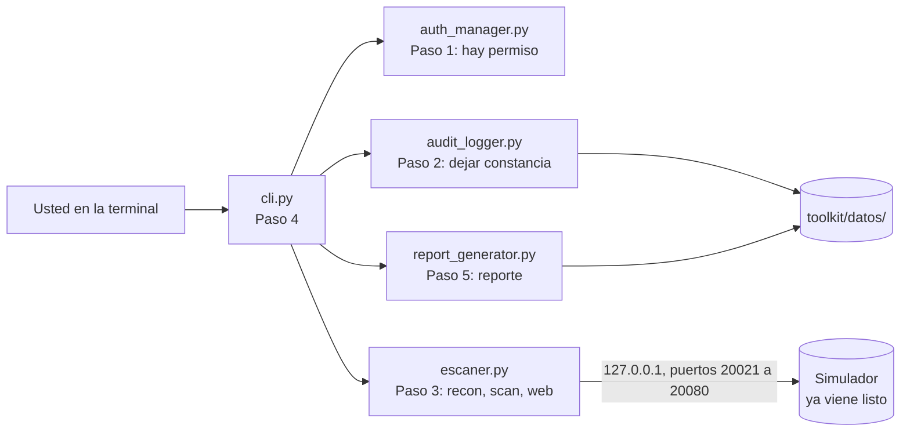

<!-- Idioma del documento: es-CO (español de Colombia) -->
# Guía paso a paso: arme su toolkit de pruebas de seguridad autorizadas

En los laboratorios anteriores usted escribió herramientas sueltas. Aquí las junta en **un solo programa que se niega a trabajar sin permiso**, deja constancia de todo lo que hace y entrega un reporte que un cliente podría leer. Es la diferencia entre tener herramientas y tener una forma profesional de trabajar.

En cada paso usted crea un archivo, pega el código de la guía, lo ejecuta y ve algo funcionando. Antes de ejecutar, la guía le pide **anotar qué cree que va a pasar**: compare su apuesta con lo que muestra la terminal. El código viene comentado al final de cada línea para que lo lea sin saltar a otro lado.

Siglas que va a encontrar: CLI (Command Line Interface, interfaz de línea de comandos), IP (Internet Protocol, dirección de un equipo en la red), TCP (Transmission Control Protocol, protocolo de control de transmisión), HTTP (Hypertext Transfer Protocol, protocolo de transferencia de hipertexto), URL (Uniform Resource Locator, dirección de una página), JSON (JavaScript Object Notation, formato de texto para datos), HTML (HyperText Markup Language, lenguaje de las páginas web) y CVE (Common Vulnerabilities and Exposures, identificador público de una vulnerabilidad).

## Antes de empezar

### Qué ya viene en esta carpeta y qué crea usted

| Ya viene listo (no lo modifique) | Para qué sirve |
|---|---|
| `simulador_servicios.py` | Hace de "equipo del cliente": publica en `127.0.0.1` servicios con software antiguo. Solo envía textos. |
| `authorization.ejemplo.json`, `preparar_autorizacion.py` | El modelo del permiso y el script que lo deja vigente desde hoy. |
| `pasos/` | Un script de comprobación para los pasos 1, 2 y 3. |
| `toolkit/tests/` (menos `test_autorizacion.py`) | 21 pruebas automáticas que revisan su código. |
| `validar.py` | Validación final del laboratorio (Paso 7). |
| `ejecutar_laboratorio.sh`, `limpiar.sh` | Comprobación completa de una vez y limpieza. |

| Lo crea usted (pegando el código de la guía) | Paso |
|---|---|
| `toolkit/modules/auth_manager.py` | 1 |
| `toolkit/modules/audit_logger.py` | 2 |
| `toolkit/modules/escaner.py` | 3 |
| `toolkit/cli.py` | 4 |
| `toolkit/templates/reporte.html` y `toolkit/modules/report_generator.py` | 5 |
| `toolkit/tests/test_autorizacion.py` | 6 |

### Cómo trabajar cada paso

1. **Lea el concepto** del paso: qué va a construir y por qué.
2. **Cree el archivo** en la ruta indicada, dentro de esta carpeta. Por ejemplo, `code toolkit/modules/auth_manager.py` (VS Code) o `nano toolkit/modules/auth_manager.py`.
3. **Copie el bloque de código completo** y péguelo. En GitHub, cada bloque tiene un botón de copiar en la esquina superior derecha.
4. **Guarde**, anote su apuesta y **ejecute la comprobación**. Compare su salida con la esperada.
5. **Lea los comentarios** del código y la sección "Fíjese en".

Si algo no funciona, lo más común es una línea que quedó por fuera al pegar o una sangría cambiada. Compare con la respuesta: `diff toolkit/cli.py ../solucion/toolkit/cli.py` (si no muestra nada, son idénticos).

### Cómo se ve el laboratorio



Cada orden pasa por el mismo camino: **permiso válido, objetivo autorizado, módulo, evidencia y auditoría**. Si falla cualquier eslabón, el toolkit se detiene, lo anota y sale con código 1. El simulador escucha solo en `127.0.0.1`, así que ningún paquete sale de su equipo.

### Requisitos

- Linux, macOS o Windows con WSL (Windows Subsystem for Linux, subsistema de Linux para Windows).
- Python 3.10 o superior, con `venv` y `pip`.
- Un editor de código (VS Code, nano o vim) y un navegador para ver el reporte.
- Dos terminales abiertas en esta carpeta (`paso-a-paso/`): la **terminal A** para el simulador y la **terminal B** para todo lo demás.

### Python que va a ver por primera vez aquí

- **Un paquete es una carpeta de módulos.** `toolkit/` y `toolkit/modules/` tienen un archivo `__init__.py` vacío: eso le dice a Python "esta carpeta es un paquete". Por eso se importa con puntos: `from toolkit.modules.auth_manager import ...`.
- **`python3 -m toolkit.cli`** ejecuta el archivo `toolkit/cli.py` como programa. Funciona desde esta carpeta, que es donde está `toolkit/`.
- **`try` / `except`**: "intente esto y, si ocurre tal error, haga esto otro". Así un error esperado (un permiso vencido) se convierte en un mensaje claro.
- **`raise`** lanza un error a propósito y detiene lo que se estaba haciendo.
- **`with`** abre algo (un archivo, una conexión) y lo cierra solo al terminar el bloque, pase lo que pase.
- **Cómo leer un error:** lea primero la **última línea** del `Traceback`. `IndentationError` es sangría; `ModuleNotFoundError: No module named 'toolkit'` significa que la terminal no está en `paso-a-paso/`.

## Paso 0: preparar el entorno

```bash
cd pyhacklabcap8/paso-a-paso        # ajuste la ruta si clonó el repositorio en otro lugar
python3 -m venv .venv               # crea un Python propio para este laboratorio
source .venv/bin/activate           # lo activa: la línea empezará con (.venv)
pip install -r requirements.txt     # instala jinja2 (plantillas) y pytest (pruebas)
python3 -c "import jinja2, pytest; print('Dependencias OK')"
```

Salida esperada: `Dependencias OK`. Active el entorno en **ambas** terminales: cada terminal nueva empieza sin él.

> Sin Internet: cree el entorno con `python3 -m venv --system-site-packages .venv` para reutilizar lo que ya tenga instalado.

## Paso 1: el permiso (`toolkit/modules/auth_manager.py`)

**Concepto.** Un cerrajero serio no abre una puerta sin ver la orden del dueño. Su toolkit tampoco: antes de cualquier conexión lee `authorization.json` y revisa que tenga todos los campos, que hoy esté dentro de la vigencia y que el objetivo esté en la lista de activos autorizados.

Primero cree el permiso. El script copia el ejemplo y pone las fechas desde hoy hasta dentro de 30 días:

```bash
python3 preparar_autorizacion.py
```

```text
[+] authorization.json creado: vigente del AAAA-MM-DD al AAAA-MM-DD
    Activos autorizados: 127.0.0.1, localhost
```

Abra `authorization.json` y mírelo: es un documento corto con cliente, contacto, identificador del permiso firmado, activos y fechas. Este archivo **no se sube a Git** (está en `.gitignore`), igual que no se publicaría el contrato de un cliente.

Ahora cree el archivo `toolkit/modules/auth_manager.py`, pegue este código y guárdelo:

<!-- archivo: toolkit/modules/auth_manager.py -->
```python
"""
auth_manager.py - Control de autorización del toolkit (Paso 1).

Este texto entre tres comillas es un DOCSTRING: una nota para quien lee. Python no la ejecuta.

Un cerrajero serio no abre una puerta sin ver antes la orden del dueño. Aquí pasa
lo mismo: nada se prueba sin permiso escrito. El permiso vive en authorization.json
y este módulo lo revisa ANTES de cualquier conexión:
  1. que el archivo exista y sea JSON válido;
  2. que traiga todos los campos obligatorios;
  3. que hoy esté dentro de las fechas de vigencia;
  4. que el objetivo esté en la lista de activos autorizados.

Siglas: JSON (JavaScript Object Notation, formato de texto para datos), IP (Internet
Protocol, dirección de un equipo en la red), CIDR (Classless Inter-Domain Routing,
forma de escribir una red, como 192.0.2.0/24) y SHA-256 (Secure Hash Algorithm,
cálculo que saca una huella digital de un texto).
"""
import datetime           # fechas: qué día es hoy y cómo leer "2026-10-20"
import hashlib            # huellas digitales (hash) de un texto
import ipaddress          # entiende IP y redes; las compara como números, no como texto
import json               # lee y escribe archivos JSON
from pathlib import Path  # Path representa la ruta de un archivo

CAMPOS_REQUERIDOS = ["cliente", "contacto_autorizado", "identificador",  # lista: campos obligatorios
                     "activos_autorizados", "fecha_inicio", "fecha_fin", "tipo_prueba"]
# "identificador" es el número del permiso firmado en papel o en PDF. Este JSON no es una firma.


class AutorizacionError(Exception):  # un tipo de ERROR propio; hereda de Exception, la base de los errores
    """Error que detiene el toolkit cuando no hay un permiso válido."""


def cargar_autorizacion(ruta: str | Path) -> dict:  # recibe una ruta y devuelve un diccionario
    """Lee el archivo de autorización y comprueba campos y vigencia. Devuelve sus datos."""
    ruta = Path(ruta)  # texto -> ruta, para poder preguntarle si existe
    if not ruta.exists():  # sin archivo no hay permiso
        raise AutorizacionError(f"Archivo de autorización no encontrado: {ruta}")  # raise detiene todo
    try:  # try: intente esto; si ocurre el error de "except", atiéndalo allá
        datos = json.loads(ruta.read_text(encoding="utf-8"))  # texto JSON -> diccionario de Python
    except json.JSONDecodeError as error:  # el archivo no es JSON válido (falta una coma, una comilla...)
        raise AutorizacionError(f"{ruta} no es un JSON válido: {error}") from error
    faltantes = [c for c in CAMPOS_REQUERIDOS if not datos.get(c)]  # campos ausentes o vacíos
    if faltantes:  # una lista con elementos cuenta como verdadera
        raise AutorizacionError("Campos obligatorios faltantes: " + ", ".join(faltantes))
    try:
        inicio = datetime.date.fromisoformat(datos["fecha_inicio"])  # "2026-10-20" -> fecha
        fin = datetime.date.fromisoformat(datos["fecha_fin"])  # falla si no viene como AAAA-MM-DD
    except ValueError:
        raise AutorizacionError("Fechas con formato inválido: use AAAA-MM-DD "
                                "o ejecute python3 preparar_autorizacion.py") from None
    hoy = datetime.date.today()  # la fecha de su computador
    if not inicio <= hoy <= fin:  # se lee: "hoy está entre inicio y fin"
        raise AutorizacionError(f"Autorización fuera de vigencia ({inicio} a {fin}). Hoy: {hoy}")
    return datos  # todo en orden: entrega el permiso


def _como_ip(texto: str):  # el guion bajo inicial indica "uso interno de este archivo"
    """Devuelve la IP si el texto es una dirección, o None si es un nombre como 'localhost'."""
    try:
        return ipaddress.ip_address(texto)  # "127.0.0.1" -> dirección IP
    except ValueError:  # no es una IP: es un nombre
        return None  # None significa "nada"


def verificar_activo_autorizado(objetivo: str, autorizacion: dict) -> bool:
    """Indica si el objetivo está autorizado: IP dentro de una red listada o nombre idéntico.

    "127.0.0.10" empieza con el mismo texto que "127.0.0.1", pero es otro equipo.
    Por eso no se compara como texto: ipaddress compara las direcciones como números.
    """
    ip = _como_ip(objetivo)
    for activo in autorizacion.get("activos_autorizados", []):  # recorre cada activo del permiso
        if ip is None:  # el objetivo es un nombre: debe coincidir completo
            if objetivo.lower() == activo.lower():  # .lower() pasa a minúsculas antes de comparar
                return True  # return termina la función y entrega el resultado
            continue  # continue salta al siguiente activo
        try:
            red = ipaddress.ip_network(activo, strict=False)  # "127.0.0.1" = un equipo; "x/24" = una red
        except ValueError:  # este activo es un nombre: no aplica a una IP
            continue
        if ip in red:  # pertenencia real a la red, calculada con números
            return True
    return False  # ningún activo coincidió


def huella_autorizacion(autorizacion: dict) -> str:
    """Huella corta (SHA-256) del permiso: si alguien cambia el archivo, la huella cambia."""
    contenido = json.dumps(autorizacion, sort_keys=True, ensure_ascii=False)  # mismo contenido, mismo texto
    return hashlib.sha256(contenido.encode("utf-8")).hexdigest()[:16]  # [:16] = primeros 16 caracteres
```

**Fíjese en:**

- `verificar_activo_autorizado` no compara texto: convierte el objetivo en una dirección IP y pregunta si está **dentro** de cada red del permiso. `127.0.0.1` en el permiso equivale a una red de un solo equipo.
- Los nombres (como `localhost`) deben coincidir completos. `localhost.ejemplo.com` contiene la palabra `localhost`, pero es otro equipo.
- `huella_autorizacion` resume el permiso en 16 caracteres. Si alguien cambia una coma del archivo, la huella cambia: por eso aparece en cada orden y en el reporte.

**Antes de ejecutar, anote su apuesta:** el script prueba seis objetivos contra su permiso, que solo autoriza `127.0.0.1` y `localhost`. ¿Cuáles acepta? Mire con cuidado `127.0.0.10`.

```bash
python3 pasos/paso1_autorizacion.py
```

Salida esperada. Donde dice `AAAA-MM-DD` usted verá sus fechas, y donde dice `<huella>`, 16 letras y números:

```text
Cliente: Laboratorio local del curso | Vigencia: AAAA-MM-DD a AAAA-MM-DD
Huella: <huella>

Objetivo               ¿Autorizado?
127.0.0.1              sí
127.0.0.10             NO
localhost              sí
LOCALHOST              sí
localhost.ejemplo.com  NO
192.0.2.10             NO
```

`127.0.0.10` empieza con las mismas letras que `127.0.0.1`, pero es otro equipo. Una comparación de texto lo habría dejado pasar; la comparación de direcciones no.

## Paso 2: la constancia de todo (`toolkit/modules/audit_logger.py`)

**Concepto.** La portería de un edificio lleva una minuta: quién entró, a qué apartamento, a qué hora. El registro de auditoría es esa minuta para su toolkit. Cada acción, permitida o negada, queda en `toolkit/datos/audit_AAAA-MM-DD.log`. Los hallazgos de cada módulo se guardan aparte en archivos JSON, y el reporte los lee de ahí.

Cree el archivo `toolkit/modules/audit_logger.py`, pegue este código y guárdelo:

<!-- archivo: toolkit/modules/audit_logger.py -->
```python
"""
audit_logger.py - Registro de auditoría y evidencias del toolkit (Paso 2).

Piense en la minuta de la portería de un edificio: quién entró, a qué apartamento,
a qué hora y qué pasó. La auditoría es esa minuta: QUIÉN hizo QUÉ, CONTRA QUÉ
objetivo, CUÁNDO y con QUÉ resultado. También queda escrito lo que se negó.

Todo se guarda en toolkit/datos/. Esa ruta se calcula desde la ubicación de ESTE
archivo, no desde la carpeta en la que esté parada la terminal: ejecute el toolkit
desde donde lo ejecute, los datos quedan en el mismo lugar. La variable de entorno
TOOLKIT_DATOS cambia esa carpeta; las pruebas la usan para no mezclar sus datos con los suyos.

Archivos que se crean:
  datos/audit_AAAA-MM-DD.log  una línea por acción, un archivo por día
  datos/resultado_*.json      los hallazgos de cada módulo, que luego lee el reporte
"""
import datetime
import getpass            # getuser() dice qué usuario del sistema ejecuta el programa
import json
import logging            # el sistema de registros que trae Python
import os                 # os.getenv lee variables de entorno
import re                 # expresiones regulares: para leer de nuevo las líneas del registro
from pathlib import Path

PAQUETE = Path(__file__).resolve().parents[1]  # __file__ = este archivo; parents[1] sube a toolkit/
FORMATO = "%(asctime)s | %(levelname)-8s | %(message)s"  # fecha | nivel | mensaje
PATRON = re.compile(r"^(\S+ \S+) \| (\w+)\s*\| USUARIO=(\S+) \| ACCION=(\S+) \| "  # cada ( ) captura
                    r"OBJETIVO=(\S+) \| RESULTADO=(.*)$")  # un dato de la línea


def carpeta_datos() -> Path:
    """Carpeta de registros y resultados. La crea si no existe."""
    carpeta = Path(os.getenv("TOOLKIT_DATOS", PAQUETE / "datos"))  # la variable de entorno, o toolkit/datos
    carpeta.mkdir(parents=True, exist_ok=True)  # exist_ok=True: no falla si ya existe
    return carpeta


def configurar_logger() -> logging.Logger:
    """Prepara el registro de auditoría: cada mensaje va al archivo del día."""
    logger = logging.getLogger("toolkit")  # el mismo nombre devuelve siempre el mismo registro
    for manejador in list(logger.handlers):  # quita configuraciones anteriores, si las hay
        logger.removeHandler(manejador)
        manejador.close()  # cierra el archivo anterior
    logger.setLevel(logging.INFO)  # guarda INFO, WARNING y ERROR
    logger.propagate = False  # no repite los mensajes en la consola
    nombre = f"audit_{datetime.date.today().isoformat()}.log"  # audit_2026-10-20.log
    archivo = logging.FileHandler(carpeta_datos() / nombre, encoding="utf-8")  # el operador / une rutas
    archivo.setFormatter(logging.Formatter(FORMATO, datefmt="%Y-%m-%d %H:%M:%S"))
    logger.addHandler(archivo)
    return logger


def _una_linea(texto) -> str:
    """Deja el texto en una sola línea: así nadie puede colar una línea falsa en el registro."""
    return " ".join(str(texto).split()) or "-"  # split() corta por espacios y saltos; join une con uno


def registrar(logger: logging.Logger, accion: str, objetivo: str, resultado,
              nivel: int = logging.INFO) -> None:  # nivel vale INFO si no se indica otro
    """Escribe una acción en el registro: usuario, acción, objetivo y resultado."""
    logger.log(nivel, "USUARIO=%s | ACCION=%s | OBJETIVO=%s | RESULTADO=%s",  # cada %s se llena en orden
               getpass.getuser(), _una_linea(accion),
               _una_linea(objetivo).replace(" ", "_"), _una_linea(resultado))  # objetivo sin espacios


def leer_auditoria() -> list[dict]:
    """Lee todas las líneas de los archivos audit_*.log y las devuelve como diccionarios."""
    entradas = []  # lista vacía que se va llenando
    for archivo in sorted(carpeta_datos().glob("audit_*.log")):  # glob busca archivos por patrón
        for linea in archivo.read_text(encoding="utf-8").splitlines():  # una línea a la vez
            m = PATRON.match(linea)  # m vale None si la línea no tiene el formato
            if m:  # m[1], m[2]... son los datos capturados por cada ( )
                entradas.append({"fecha": m[1], "nivel": m[2], "usuario": m[3],
                                 "accion": m[4], "objetivo": m[5], "resultado": m[6]})
    return entradas


def guardar_resultado(resultado: dict) -> Path:
    """Guarda en JSON lo que devolvió un módulo, con fecha y hora en el nombre."""
    marca = datetime.datetime.now().strftime("%Y%m%d_%H%M%S_%f")  # %f = microsegundos: nombres únicos
    ruta = carpeta_datos() / f"resultado_{resultado['modulo']}_{marca}.json"
    ruta.write_text(json.dumps(resultado, indent=2, ensure_ascii=False), encoding="utf-8")  # indent: legible
    return ruta


def leer_resultados() -> list[dict]:
    """Devuelve todos los resultados guardados, del más antiguo al más reciente."""
    def fecha_del_nombre(archivo: Path) -> str:  # una función puede ir dentro de otra
        return archivo.name.split("_", 2)[2]  # "resultado_scan_20261020_..." -> "20261020_..."

    archivos = sorted(carpeta_datos().glob("resultado_*.json"), key=fecha_del_nombre)  # key: orden por fecha
    return [json.loads(a.read_text(encoding="utf-8")) for a in archivos]  # cada archivo -> diccionario
```

**Fíjese en:**

- `PAQUETE` se calcula desde la ubicación del archivo. Ejecute el toolkit desde donde lo ejecute, los datos quedan en `toolkit/datos/`.
- `_una_linea` aplana el texto. Un banner con un salto de línea en medio no puede fabricar una línea falsa en el registro.
- `TOOLKIT_DATOS` permite que las pruebas usen una carpeta temporal y no ensucien su registro real.

**Antes de ejecutar, anote su apuesta:** el script registra dos acciones. La segunda trae un salto de línea en medio del texto (`no autorizado`, salto, `línea falsa`). ¿Cuántas líneas tendrá el archivo: dos o tres?

```bash
python3 pasos/paso2_auditoria.py
```

Salida esperada (con su fecha y hora):

```text
--- audit_AAAA-MM-DD.log ---
AAAA-MM-DD HH:MM:SS | INFO     | USUARIO=<usuario> | ACCION=scan | OBJETIVO=127.0.0.1 | RESULTADO=2 hallazgo(s)
AAAA-MM-DD HH:MM:SS | WARNING  | USUARIO=<usuario> | ACCION=scan | OBJETIVO=192.0.2.10 | RESULTADO=DENEGADO: no autorizado línea falsa

Entradas leídas de vuelta: 2
```

Dos líneas: el salto quedó aplanado. Ahora corra las pruebas de este archivo:

```bash
python3 -m pytest toolkit/tests/test_auditoria.py
```

Debe terminar en `5 passed`.

## Paso 3: los tres módulos (`toolkit/modules/escaner.py`)

**Concepto.** Aquí vuelve lo que ya sabe hacer: leer el banner de un puerto, como en el laboratorio 4, y revisar las cabeceras de una página web. Lo nuevo es la forma de la respuesta. Los tres módulos (`recon`, `scan` y `web`) devuelven lo mismo: qué módulo, contra qué objetivo, qué vio y **qué hallazgos salen de lo que vio**, cada uno con su evidencia.

Cree el archivo `toolkit/modules/escaner.py`, pegue este código y guárdelo:

<!-- archivo: toolkit/modules/escaner.py -->
```python
"""
escaner.py - Los tres módulos de prueba del toolkit (Paso 3).

  reconocer(nombre)            resuelve un nombre a sus direcciones IP.
  escanear(host, puertos, t)   se conecta a cada puerto y lee su banner, como en el laboratorio 4.
  revisar_web(url, t)          pide la página y revisa sus cabeceras HTTP.

Los tres devuelven un diccionario con la misma forma:
  {"modulo": ..., "objetivo": ..., "detalle": ..., "hallazgos": [...]}
Cada hallazgo sale de lo que el módulo OBSERVÓ y trae su evidencia. Nada se inventa.
Este archivo no revisa permisos: eso lo hace la CLI (Paso 4) antes de llamarlo.

Siglas: TCP (Transmission Control Protocol, protocolo de control de transmisión),
HTTP (Hypertext Transfer Protocol, protocolo de transferencia de hipertexto),
URL (Uniform Resource Locator, dirección de una página) y CVE (Common
Vulnerabilities and Exposures, identificador público de una vulnerabilidad).
"""
import socket            # conexiones de red de bajo nivel
import urllib.error      # los errores que puede devolver una petición web
import urllib.request    # peticiones HTTP con la librería que trae Python

VERSIONES_ANTIGUAS = {  # diccionario: texto que delata una versión antigua -> por qué es un riesgo
    "vsFTPd 2.3.4": "vsftpd 2.3.4 tiene una puerta trasera pública (CVE-2011-2523)",
    "OpenSSH_4.": "OpenSSH 4 está sin soporte desde hace más de quince años",
    "Apache/2.2": "Apache 2.2 terminó su soporte en 2017",
}
CABECERAS_SEGURIDAD = {  # cabeceras que protegen a quien visita la página -> para qué sirven
    "Content-Security-Policy": "limita de dónde puede cargar código la página",
    "X-Frame-Options": "impide que otra página la muestre dentro de un marco",
    "X-Content-Type-Options": "evita que el navegador adivine el tipo de archivo",
}


def hallazgo(severidad: str, descripcion: str, recomendacion: str, evidencia: str) -> dict:
    """Arma un hallazgo con los cuatro datos que pide un reporte."""
    return {"severidad": severidad, "descripcion": descripcion,
            "recomendacion": recomendacion, "evidencia": evidencia}


def _por_version(donde: str, texto: str) -> dict:
    """Clasifica un texto que revela software: HIGH si es una versión antigua, LOW si no."""
    for antigua, motivo in VERSIONES_ANTIGUAS.items():  # .items() entrega pares (clave, valor)
        if antigua in texto:  # ¿el texto contiene la versión antigua?
            return hallazgo("HIGH", f"{donde}: versión antigua expuesta. {motivo}",
                            "Actualizar el servicio a una versión con soporte", texto)
    return hallazgo("LOW", f"{donde}: el servicio dice qué software usa",
                    "Ocultar el producto y la versión en la configuración del servicio", texto)


def reconocer(nombre: str) -> dict:
    """Resuelve un nombre (por ejemplo, localhost) a sus direcciones IPv4."""
    respuestas = socket.getaddrinfo(nombre, None, socket.AF_INET)  # pregunta al sistema; AF_INET = IPv4
    ips = sorted({r[4][0] for r in respuestas})  # { } sin repetidos; r[4][0] es la IP de cada respuesta
    encontrado = hallazgo("INFO", f"{nombre} resuelve a {', '.join(ips)}",
                          "Confirmar que todas las direcciones estén en el permiso", ", ".join(ips))
    return {"modulo": "recon", "objetivo": nombre, "detalle": ips, "hallazgos": [encontrado]}


def leer_banner(host: str, puerto: int, timeout: float) -> str | None:
    """Devuelve el banner, "" si el puerto está abierto pero callado, o None si está cerrado."""
    try:
        with socket.create_connection((host, puerto), timeout=timeout) as conexion:  # with cierra solo
            try:
                return conexion.recv(1024).decode("utf-8", errors="replace").strip()  # bytes -> texto
            except TimeoutError:  # se conectó, pero el servicio no dijo nada a tiempo
                return ""
    except OSError:  # conexión rechazada: puerto cerrado
        return None


def escanear(host: str, puertos: list[int], timeout: float) -> dict:
    """Lee el banner de cada puerto y convierte lo observado en hallazgos."""
    detalle, hallazgos = {}, []  # dos variables en una línea: diccionario vacío y lista vacía
    for puerto in puertos:
        banner = leer_banner(host, puerto, timeout)
        if banner is None:  # "is None" pregunta si no hay nada
            detalle[puerto] = "cerrado"
        elif banner == "":  # elif = "si no, y si..."
            detalle[puerto] = "abierto, sin banner"
            hallazgos.append(hallazgo("INFO", f"Puerto {puerto} abierto sin banner",
                                      "Revisarlo con un módulo específico (por ejemplo, web)", "-"))
        else:  # hay banner: se clasifica
            detalle[puerto] = banner
            hallazgos.append(_por_version(f"Puerto {puerto}", banner))
    return {"modulo": "scan", "objetivo": host, "detalle": detalle, "hallazgos": hallazgos}


def revisar_web(url: str, timeout: float) -> dict:
    """Pide la URL y revisa las cabeceras de seguridad y la cabecera Server."""
    navegador = urllib.request.build_opener(urllib.request.ProxyHandler({}))  # {} = sin proxy: va directo
    pedido = urllib.request.Request(url, headers={"User-Agent": "toolkit-lab08 (prueba autorizada)"})
    try:
        with navegador.open(pedido, timeout=timeout) as respuesta:  # hace la petición GET
            estado, cabeceras = respuesta.status, respuesta.headers  # 200 y las cabeceras recibidas
    except urllib.error.HTTPError as error:  # 404, 500...: la respuesta también trae cabeceras
        estado, cabeceras = error.code, error.headers
    hallazgos = [hallazgo("MEDIUM", f"Falta la cabecera {nombre}", f"Agregarla: {uso}", url)
                 for nombre, uso in CABECERAS_SEGURIDAD.items() if nombre not in cabeceras]  # solo faltantes
    servidor = cabeceras.get("Server", "")  # .get devuelve "" si la cabecera no existe
    if any(c.isdigit() for c in servidor):  # ¿algún carácter es un dígito? entonces muestra versión
        hallazgos.insert(0, _por_version("Cabecera Server", servidor))  # insert(0, ...) lo pone de primero
    return {"modulo": "web", "objetivo": url, "detalle": {"estado": estado, "server": servidor},
            "hallazgos": hallazgos}
```

**Fíjese en:**

- `leer_banner` distingue tres casos: banner (texto), abierto pero callado (`""`) y cerrado (`None`).
- Cada hallazgo lleva la **evidencia** que lo sostiene: el banner o la URL exactos.
- `ProxyHandler({})` hace que la petición vaya directo a `127.0.0.1`, aunque su equipo tenga un proxy configurado.

En la **terminal A**, inicie el simulador y déjelo corriendo:

```bash
python3 simulador_servicios.py
```

```text
[+] Simulador escuchando en 127.0.0.1: puertos 20021, 20022, 20025, 20080
    Ctrl+C para detenerlo
```

**Antes de ejecutar, anote su apuesta:** el simulador no escucha en el 20023. ¿Qué escribirá el escaneo para ese puerto? ¿Y cuántas cabeceras de seguridad le faltan a la página web?

En la **terminal B**:

```bash
python3 pasos/paso3_modulos.py
```

```text
recon localhost -> ['127.0.0.1']

scan 127.0.0.1, puertos 20021 y 20023 ->
{
  "20021": "220 (vsFTPd 2.3.4)",
  "20023": "cerrado"
}

web -> estado 200, Server: Apache/2.2.8 (Ubuntu) DAV/2
  [HIGH] Cabecera Server: versión antigua expuesta. Apache 2.2 terminó su soporte en 2017
  [MEDIUM] Falta la cabecera Content-Security-Policy
  [MEDIUM] Falta la cabecera X-Frame-Options
  [MEDIUM] Falta la cabecera X-Content-Type-Options
```

Las pruebas de este paso levantan sus propios servicios, así que no dependen del simulador:

```bash
python3 -m pytest toolkit/tests/test_escaner.py
```

Debe terminar en `5 passed`.

## Paso 4: la CLI que lo une todo (`toolkit/cli.py`)

**Concepto.** La CLI es la puerta de entrada: usted escribe una orden y el programa decide si puede cumplirla. Primero el permiso, luego el objetivo, después el módulo y al final la constancia. Como barrera extra del laboratorio, solo acepta direcciones `127.x.x.x` (su propio equipo), aunque alguien agregue otra IP al permiso.

Cree el archivo `toolkit/cli.py`, pegue este código y guárdelo:

<!-- archivo: toolkit/cli.py -->
```python
"""
cli.py - Interfaz de línea de comandos (CLI) del toolkit (Paso 4).

CLI (Command Line Interface, interfaz de línea de comandos): el programa se
maneja escribiendo órdenes en la terminal, por ejemplo:
    python3 -m toolkit.cli scan 127.0.0.1 --puertos 20021,20022

Cada orden sigue el mismo camino, sin atajos:
    permiso válido -> objetivo autorizado -> módulo -> evidencia -> auditoría
Si algo falla, el programa se detiene, lo deja en el registro y sale con código 1.
"""
import argparse  # lee las opciones escritas en la terminal y genera la ayuda (--help)
import ipaddress
import logging
import socket
from pathlib import Path
from urllib.parse import urlsplit  # separa una URL en partes: esquema, equipo, puerto...

from toolkit.modules import escaner  # los módulos de los pasos 1, 2 y 3 (carpeta toolkit/modules/)
from toolkit.modules.audit_logger import configurar_logger, guardar_resultado, registrar
from toolkit.modules.auth_manager import (AutorizacionError, cargar_autorizacion,
                                          huella_autorizacion, verificar_activo_autorizado)


def _puertos(texto: str) -> list[int]:
    """Convierte "20021,20022" en [20021, 20022] y rechaza valores fuera de 1-65535."""
    puertos = [int(p) for p in texto.split(",")]  # int() falla si no es un número
    if not all(1 <= p <= 65535 for p in puertos):
        raise argparse.ArgumentTypeError("los puertos van de 1 a 65535")
    return puertos


def _exigir_activo(objetivo: str, auth: dict) -> None:
    """Detiene todo si el objetivo no está en el permiso o si sale del propio equipo."""
    if not verificar_activo_autorizado(objetivo, auth):
        raise AutorizacionError(f"El objetivo '{objetivo}' NO está en los activos autorizados")
    ip = ipaddress.ip_address(socket.gethostbyname(objetivo))  # nombre -> IP ("localhost" -> 127.0.0.1)
    if not ip.is_loopback:  # barrera extra del laboratorio: solo 127.x.x.x, su propio equipo
        raise AutorizacionError(f"'{objetivo}' es {ip}: el laboratorio solo trabaja en 127.0.0.0/8")


def ejecutar_modulo(args: argparse.Namespace, auth: dict) -> dict:
    """Comprueba el objetivo y llama al módulo pedido."""
    if args.comando == "web":
        url = urlsplit(args.objetivo)
        if url.scheme not in ("http", "https"):
            raise AutorizacionError("La URL debe empezar por http:// o https://")
        _exigir_activo(url.hostname or "", auth)  # se revisa el equipo de la URL
        return escaner.revisar_web(args.objetivo, args.timeout)
    _exigir_activo(args.objetivo, auth)
    if args.comando == "recon":
        return escaner.reconocer(args.objetivo)
    return escaner.escanear(args.objetivo, args.puertos, args.timeout)


def construir_parser() -> argparse.ArgumentParser:
    """Define las órdenes (subcomandos) y sus opciones."""
    parser = argparse.ArgumentParser(prog="toolkit", description="Toolkit de pruebas de "
                                     "seguridad autorizadas. Solo con permiso escrito.")
    parser.add_argument("--auth", default="authorization.json", help="archivo de autorización")
    sub = parser.add_subparsers(dest="comando", metavar="MODULO", required=True)
    recon = sub.add_parser("recon", help="resolver un nombre a sus direcciones IP")
    recon.add_argument("objetivo", help="nombre o IP, por ejemplo localhost")
    scan = sub.add_parser("scan", help="leer los banners de puertos TCP")
    scan.add_argument("objetivo", help="IP o nombre, por ejemplo 127.0.0.1")
    scan.add_argument("--puertos", type=_puertos, default="20021,20022,20023,20025,20080",
                      help="puertos separados por comas")
    web = sub.add_parser("web", help="revisar las cabeceras de seguridad de una página")
    web.add_argument("objetivo", metavar="url", help="por ejemplo http://127.0.0.1:20080/")
    for orden in (scan, web):  # las dos órdenes que se conectan aceptan --timeout
        orden.add_argument("--timeout", type=float, default=1.0, help="segundos por conexión")
    report = sub.add_parser("report", help="generar el reporte con los hallazgos guardados")
    report.add_argument("--formato", choices=["html", "markdown"], default="html")
    report.add_argument("--salida", type=Path, default=Path("reporte_final.html"))
    return parser


def main(argv: list[str] | None = None) -> int:
    """Punto de entrada: devuelve 0 si todo salió bien y 1 si se negó o falló."""
    args = construir_parser().parse_args(argv)
    logger = configurar_logger()
    objetivo = getattr(args, "objetivo", "N/A")  # report no tiene objetivo
    print("=" * 64 + "\n  TOOLKIT DE PRUEBAS AUTORIZADAS - solo con permiso escrito\n" + "=" * 64)
    try:
        auth = cargar_autorizacion(args.auth)  # sin permiso válido no se hace NADA, ni el reporte
        print(f"[AUTH] Cliente: {auth['cliente']} | Huella: {huella_autorizacion(auth)}")
        if args.comando == "report":
            from toolkit.modules.report_generator import generar_reporte  # solo report usa Jinja2
            total = generar_reporte(auth, args.formato, args.salida)
            registrar(logger, "report", "N/A", f"formato={args.formato} hallazgos={total}")
            print(f"[OK] Reporte con {total} hallazgo(s) en: {args.salida}")
            return 0
        resultado = ejecutar_modulo(args, auth)
    except AutorizacionError as error:  # permiso ausente, vencido u objetivo no autorizado
        registrar(logger, args.comando, objetivo, f"DENEGADO: {error}", logging.WARNING)
        print(f"[DENEGADO] {error}")
        return 1
    except OSError as error:  # fallas de red o de archivos: el destino no responde, etc.
        registrar(logger, args.comando, objetivo, f"ERROR: {error}", logging.ERROR)
        print(f"[ERROR] {error}")
        return 1
    ruta = guardar_resultado(resultado)
    registrar(logger, args.comando, objetivo, f"{len(resultado['hallazgos'])} hallazgo(s) en {ruta.name}")
    for h in resultado["hallazgos"]:
        print(f"  [{h['severidad']:<6}] {h['descripcion']}")
    print(f"[OK] {len(resultado['hallazgos'])} hallazgo(s) guardados en {ruta.parent.name}/{ruta.name}")
    return 0


if __name__ == "__main__":
    raise SystemExit(main())  # entrega al sistema el código de salida 0 o 1
```

**Fíjese en:**

- `argparse` arma la ayuda solo, a partir de las opciones que usted definió.
- Para `web`, el permiso se revisa sobre el **equipo** de la URL (`127.0.0.1`), no sobre la URL entera.
- `main` devuelve 0 o 1. Ese número es el código de salida: otro programa puede saber si la orden se cumplió sin leer el texto.

Mire la ayuda que se generó sola:

```bash
python3 -m toolkit.cli --help
```

```text
usage: toolkit [-h] [--auth AUTH] MODULO ...

Toolkit de pruebas de seguridad autorizadas. Solo con permiso escrito.

positional arguments:
  MODULO
    recon      resolver un nombre a sus direcciones IP
    scan       leer los banners de puertos TCP
    web        revisar las cabeceras de seguridad de una página
    report     generar el reporte con los hallazgos guardados

options:
  -h, --help   show this help message and exit
  --auth AUTH  archivo de autorización
```

Con el simulador corriendo en la terminal A, use los tres módulos:

```bash
python3 -m toolkit.cli recon localhost
python3 -m toolkit.cli scan 127.0.0.1
python3 -m toolkit.cli web http://127.0.0.1:20080/
```

Salida del escaneo (el nombre del archivo lleva su fecha y hora):

```text
================================================================
  TOOLKIT DE PRUEBAS AUTORIZADAS - solo con permiso escrito
================================================================
[AUTH] Cliente: Laboratorio local del curso | Huella: <huella>
  [HIGH  ] Puerto 20021: versión antigua expuesta. vsftpd 2.3.4 tiene una puerta trasera pública (CVE-2011-2523)
  [HIGH  ] Puerto 20022: versión antigua expuesta. OpenSSH 4 está sin soporte desde hace más de quince años
  [LOW   ] Puerto 20025: el servicio dice qué software usa
  [INFO  ] Puerto 20080 abierto sin banner
[OK] 4 hallazgo(s) guardados en datos/resultado_scan_AAAAMMDD_HHMMSS_ffffff.json
```

**Antes de ejecutar, anote su apuesta:** ¿qué hará el toolkit con `127.0.0.10`? ¿Se conectará y fallará, o no se conectará?

```bash
python3 -m toolkit.cli scan 127.0.0.10; echo "código de salida: $?"
```

```text
================================================================
  TOOLKIT DE PRUEBAS AUTORIZADAS - solo con permiso escrito
================================================================
[AUTH] Cliente: Laboratorio local del curso | Huella: <huella>
[DENEGADO] El objetivo '127.0.0.10' NO está en los activos autorizados
código de salida: 1
```

No se conectó: la negación ocurre antes de abrir cualquier conexión, y quedó escrita. Compruébelo en la minuta del día:

```bash
tail -n 2 toolkit/datos/audit_*.log
```

La última línea es un `WARNING` con `RESULTADO=DENEGADO`. Luego corra las pruebas de la CLI (no abren conexiones a otros equipos):

```bash
python3 -m pytest toolkit/tests/test_cli.py
```

Debe terminar en `6 passed`.

## Paso 5: el reporte (`reporte.html` y `report_generator.py`)

**Concepto.** El reporte es lo que el cliente lee. Junta el permiso, la minuta y **solo los hallazgos que los módulos observaron**. Si todavía no ha ejecutado ningún módulo, la sección de hallazgos lo dice en vez de inventar. Jinja2 llena una plantilla HTML con esos datos: `{{ proyecto.cliente }}` se reemplaza por el nombre del cliente.

Cree la carpeta de plantillas:

```bash
mkdir -p toolkit/templates
```

Cree el archivo `toolkit/templates/reporte.html`, pegue esta plantilla y guárdela:

<!-- archivo: toolkit/templates/reporte.html -->
```html
<!DOCTYPE html>
<html lang="es-CO">
<head>
  <meta charset="UTF-8">
  <title>Reporte de pruebas de seguridad autorizadas</title>
  <style>
    body { font-family: Arial, sans-serif; max-width: 980px; margin: 40px auto; color: #222; }
    table { width: 100%; border-collapse: collapse; margin-top: 12px; }
    th { background: #1a1a2e; color: #fff; padding: 8px; text-align: left; }
    td { padding: 6px 8px; border-bottom: 1px solid #ddd; vertical-align: top; }
    .aviso { background: #fff3cd; border-left: 4px solid #ffc107; padding: 10px 14px; }
    .HIGH, .CRITICAL { color: #b00020; font-weight: bold; }
    .MEDIUM { color: #b36b00; font-weight: bold; }
  </style>
</head>
<body>
  {# Esto es un comentario de Jinja2: no aparece en el reporte. {{ x }} se reemplaza por el valor de x. #}
  <h1>Reporte de pruebas de seguridad autorizadas</h1>
  <p class="aviso">Confidencial. Generado el {{ proyecto.generado }}. Solo para el cliente autorizado.</p>

  <h2>1. Proyecto</h2>
  <table>
    <tr><th>Campo</th><th>Valor</th></tr>
    <tr><td>Cliente</td><td>{{ proyecto.cliente }}</td></tr>
    <tr><td>Identificador del permiso</td><td>{{ proyecto.identificador }}</td></tr>
    <tr><td>Tipo de prueba</td><td>{{ proyecto.tipo_prueba }}</td></tr>
    <tr><td>Vigencia</td><td>{{ proyecto.vigencia }}</td></tr>
    <tr><td>Huella de la autorización</td><td><code>{{ proyecto.huella }}</code></td></tr>
  </table>

  <h2>2. Resumen</h2>
  <p>{{ severidad }}: {{ cantidad }} | </p>

  <h2>3. Hallazgos</h2>
  
  <table>
    <tr><th>ID</th><th>Severidad</th><th>Módulo</th><th>Descripción</th><th>Evidencia</th><th>Recomendación</th></tr>
    
    <tr><td>{{ h.id }}</td><td class="{{ h.severidad }}">{{ h.severidad }}</td><td>{{ h.modulo }}</td>
        <td>{{ h.descripcion }}</td><td><code>{{ h.evidencia }}</code></td><td>{{ h.recomendacion }}</td></tr>
    
  </table>
  
  <p>Sin hallazgos: ejecute recon, scan o web antes de generar el reporte.</p>
  

  <h2>4. Registro de auditoría</h2>
  <table>
    <tr><th>Fecha</th><th>Nivel</th><th>Usuario</th><th>Acción</th><th>Objetivo</th><th>Resultado</th></tr>
    
    <tr><td>{{ e.fecha }}</td><td>{{ e.nivel }}</td><td>{{ e.usuario }}</td><td>{{ e.accion }}</td>
        <td>{{ e.objetivo }}</td><td>{{ e.resultado }}</td></tr>
    
  </table>
</body>
</html>
```

Ahora cree `toolkit/modules/report_generator.py`, pegue este código y guárdelo:

<!-- archivo: toolkit/modules/report_generator.py -->
```python
"""
report_generator.py - Reporte final en HTML o Markdown (Paso 5).

Junta tres cosas: los datos del permiso, el registro de auditoría y los
hallazgos que guardaron los módulos. Solo reporta lo que los módulos
observaron: si no se ha ejecutado ningún módulo, la sección de hallazgos
queda vacía y lo dice.

Jinja2 es una librería de PLANTILLAS: un HTML con huecos {{ variable }} que se
llenan con datos. Con autoescape=True, Jinja2 convierte < y > en &lt; y &gt;,
así un banner con etiquetas HTML se MUESTRA como texto y no se ejecuta en el
navegador de quien abra el reporte.

Siglas: HTML (HyperText Markup Language, lenguaje de las páginas web).
"""
import datetime
import re
from pathlib import Path

from jinja2 import Environment, FileSystemLoader  # se instala con requirements.txt

from toolkit.modules.audit_logger import leer_auditoria, leer_resultados
from toolkit.modules.auth_manager import huella_autorizacion

PLANTILLAS = Path(__file__).resolve().parents[1] / "templates"  # toolkit/templates/
ORDEN = ["CRITICAL", "HIGH", "MEDIUM", "LOW", "INFO"]  # de más grave a menos grave


def ofuscar(texto: str) -> str:
    """Oculta datos sensibles: el último número de cada IP y el valor de las contraseñas."""
    texto = re.sub(r"\b(\d{1,3}\.\d{1,3}\.\d{1,3})\.\d{1,3}\b", r"\1.***", texto)  # \1 = lo del grupo ( )
    return re.sub(r"(password|passwd|pwd|clave)=\S+", r"\1=*****", texto, flags=re.IGNORECASE)


def recopilar_hallazgos() -> list[dict]:
    """Une los hallazgos de todos los resultados, sin repetidos, del más grave al menos grave."""
    unicos = {}  # diccionario: (módulo, objetivo, descripción) -> hallazgo; el más reciente reemplaza
    for resultado in leer_resultados():
        for h in resultado["hallazgos"]:
            clave = (resultado["modulo"], resultado["objetivo"], h["descripcion"])  # repetido = misma clave
            unicos[clave] = {**h, "modulo": resultado["modulo"],  # ** copia todos los campos de h
                             "descripcion": ofuscar(h["descripcion"]), "evidencia": ofuscar(h["evidencia"])}

    def gravedad(h: dict) -> int:  # posición de la severidad en ORDEN: 0 = la más grave
        return ORDEN.index(h["severidad"])

    hallazgos = sorted(unicos.values(), key=gravedad)  # sorted ordena; key dice con qué criterio
    for numero, h in enumerate(hallazgos, start=1):  # enumerate numera: 1, 2, 3...
        h["id"] = f"HALL-{numero:03d}"  # :03d rellena con ceros: HALL-001
    return hallazgos


def generar_reporte(auth: dict, formato: str, salida: Path) -> int:
    """Escribe el reporte y devuelve cuántos hallazgos incluyó."""
    hallazgos = recopilar_hallazgos()
    auditoria = [{**e, "objetivo": ofuscar(e["objetivo"]), "resultado": ofuscar(e["resultado"])}
                 for e in leer_auditoria()]
    contexto = {
        "proyecto": {"cliente": auth["cliente"], "identificador": auth["identificador"],
                     "tipo_prueba": auth["tipo_prueba"],
                     "vigencia": f"{auth['fecha_inicio']} a {auth['fecha_fin']}",
                     "huella": huella_autorizacion(auth),
                     "generado": datetime.datetime.now().strftime("%Y-%m-%d %H:%M:%S")},
        "resumen": {sev: sum(h["severidad"] == sev for h in hallazgos) for sev in ORDEN},
        "auditoria": auditoria,
        "hallazgos": hallazgos,
    }
    if formato == "html":
        entorno = Environment(loader=FileSystemLoader(PLANTILLAS), autoescape=True)  # escapa SIEMPRE < y >
        texto = entorno.get_template("reporte.html").render(**contexto)  # ** pasa cada clave como variable
    else:
        texto = _markdown(contexto)
    salida.parent.mkdir(parents=True, exist_ok=True)
    salida.write_text(texto, encoding="utf-8")
    return len(hallazgos)


def _celda(texto) -> str:
    """Prepara un texto para una tabla Markdown: escapa | y <, y lo deja en una línea."""
    return " ".join(str(texto).split()).replace("|", "\\|").replace("<", "&lt;")


def _markdown(ctx: dict) -> str:
    """Arma el mismo reporte en Markdown, un formato de texto que GitHub muestra con estilo."""
    p = ctx["proyecto"]
    lineas = ["# Reporte de pruebas de seguridad autorizadas", "",
              f"Confidencial. Generado el {p['generado']}.", "", "## 1. Proyecto", "",
              f"- Cliente: {p['cliente']}", f"- Identificador del permiso: {p['identificador']}",
              f"- Tipo de prueba: {p['tipo_prueba']}", f"- Vigencia: {p['vigencia']}",
              f"- Huella de la autorización: `{p['huella']}`", "", "## 2. Resumen", "",
              ", ".join(f"{sev}: {n}" for sev, n in ctx["resumen"].items()), "",
              "## 3. Hallazgos", ""]
    if not ctx["hallazgos"]:
        lineas.append("Sin hallazgos: ejecute recon, scan o web antes de generar el reporte.")
    else:
        lineas += ["| ID | Severidad | Módulo | Descripción | Evidencia | Recomendación |",
                   "|---|---|---|---|---|---|"]
        lineas += [f"| {h['id']} | {h['severidad']} | {h['modulo']} | {_celda(h['descripcion'])} | "
                   f"{_celda(h['evidencia'])} | {_celda(h['recomendacion'])} |" for h in ctx["hallazgos"]]
    lineas += ["", "## 4. Registro de auditoría", "", f"{len(ctx['auditoria'])} acción(es) registradas."]
    return "\n".join(lineas) + "\n"
```

**Fíjese en:**

- `autoescape=True` está escrito de forma explícita. Jinja2 convierte `<` en `&lt;`, así que un banner con etiquetas HTML se ve como texto y no se ejecuta en el navegador de quien abre el reporte.
- `recopilar_hallazgos` quita repetidos: si escanea dos veces lo mismo, el hallazgo aparece una sola vez.
- `ofuscar` oculta el último número de cada IP y el valor de cualquier contraseña. El reporte circula; los datos sensibles, no.

**Antes de ejecutar, anote su apuesta:** el banner del puerto 20025 trae la etiqueta `<b>correo.lab</b>`. Cuando abra el reporte en el navegador, ¿verá `correo.lab` en negrita o verá las etiquetas como texto?

```bash
python3 -m toolkit.cli report
python3 -m toolkit.cli report --formato markdown --salida reporte_final.md
```

```text
================================================================
  TOOLKIT DE PRUEBAS AUTORIZADAS - solo con permiso escrito
================================================================
[AUTH] Cliente: Laboratorio local del curso | Huella: <huella>
[OK] Reporte con 9 hallazgo(s) en: reporte_final.html
================================================================
  TOOLKIT DE PRUEBAS AUTORIZADAS - solo con permiso escrito
================================================================
[AUTH] Cliente: Laboratorio local del curso | Huella: <huella>
[OK] Reporte con 9 hallazgo(s) en: reporte_final.md
```

Abra `reporte_final.html` en el navegador (`xdg-open reporte_final.html` en Linux, `open reporte_final.html` en macOS, `explorer.exe reporte_final.html` en WSL). Verá cuatro secciones: proyecto, resumen (`CRITICAL: 0 | HIGH: 3 | MEDIUM: 3 | LOW: 1 | INFO: 2`), hallazgos del HALL-001 al HALL-009 y la minuta. En el hallazgo del puerto 20025, las etiquetas aparecen como texto. `reporte_final.md` trae lo mismo en Markdown, el formato que GitHub muestra con estilo.

Si ejecutó los módulos más de una vez con los mismos objetivos, el total no cambia; con otros objetivos, sí. Lo que cuenta es que cada hallazgo venga de algo que un módulo vio.

**Un error que vale la pena ver:** pida el reporte con un permiso que no existe.

```bash
python3 -m toolkit.cli --auth no_existe.json report --salida sin_permiso.html; echo "código: $?"
```

```text
================================================================
  TOOLKIT DE PRUEBAS AUTORIZADAS - solo con permiso escrito
================================================================
[DENEGADO] Archivo de autorización no encontrado: no_existe.json
código: 1
```

No hay reporte sin permiso: `sin_permiso.html` no se creó. Corra las pruebas del reporte:

```bash
python3 -m pytest toolkit/tests/test_reporte.py
```

Debe terminar en `5 passed`.

## Paso 6: sus propias pruebas (`toolkit/tests/test_autorizacion.py`)

**Concepto.** Una prueba automática es una pregunta con respuesta conocida: "si le doy `127.0.0.10`, ¿lo niega?". pytest las corre todas en un segundo, cada vez que usted cambie algo. Así, un cambio que rompa el permiso se descubre en su equipo y no en el del cliente.

Cree el archivo `toolkit/tests/test_autorizacion.py`, pegue este código y guárdelo:

<!-- archivo: toolkit/tests/test_autorizacion.py -->
```python
"""
test_autorizacion.py - Pruebas del control de autorización (Paso 6).

pytest busca solo los archivos test_*.py y, dentro de ellos, las funciones test_*.
Cada prueba prepara un caso, llama al código y comprueba el resultado con assert:
si lo que va después de assert es falso, la prueba falla y pytest muestra por qué.
"""
import datetime  # para calcular fechas relativas a hoy
import json

import pytest  # el programa de pruebas; aquí se usan pytest.raises y pytest.mark

from toolkit.modules.auth_manager import (AutorizacionError, cargar_autorizacion,
                                          huella_autorizacion, verificar_activo_autorizado)

HOY = datetime.date.today()
UN_DIA = datetime.timedelta(days=1)  # timedelta = una duración de tiempo
PERMISO = {"cliente": "Cliente de prueba", "contacto_autorizado": "Instructor", "identificador": "P-1",
           "activos_autorizados": ["127.0.0.1", "localhost", "192.0.2.0/24"],  # 192.0.2.x: red de documentación
           "fecha_inicio": (HOY - UN_DIA).isoformat(), "fecha_fin": (HOY + UN_DIA).isoformat(),
           "tipo_prueba": "caja_gris"}


def _archivo(tmp_path, **cambios) -> str:  # **cambios recibe pares nombre=valor
    """Escribe un permiso de prueba en una carpeta temporal y devuelve su ruta."""
    ruta = tmp_path / "authorization.json"  # tmp_path: carpeta temporal que pytest crea por prueba
    ruta.write_text(json.dumps({**PERMISO, **cambios}), encoding="utf-8")  # el permiso con los cambios
    return str(ruta)


def test_permiso_vigente_se_carga(tmp_path):
    assert cargar_autorizacion(_archivo(tmp_path))["cliente"] == "Cliente de prueba"


def test_archivo_inexistente_se_rechaza(tmp_path):
    with pytest.raises(AutorizacionError, match="no encontrado"):  # la prueba pasa SI ocurre ese error
        cargar_autorizacion(tmp_path / "no_existe.json")


def test_campo_vacio_se_rechaza(tmp_path):
    with pytest.raises(AutorizacionError, match="identificador"):
        cargar_autorizacion(_archivo(tmp_path, identificador=""))


def test_permiso_vencido_se_rechaza(tmp_path):
    with pytest.raises(AutorizacionError, match="vigencia"):
        cargar_autorizacion(_archivo(tmp_path, fecha_inicio="2020-01-01", fecha_fin="2020-12-31"))


def test_fecha_mal_escrita_se_rechaza(tmp_path):
    with pytest.raises(AutorizacionError, match="AAAA-MM-DD"):
        cargar_autorizacion(_archivo(tmp_path, fecha_fin="31/12/2030"))


@pytest.mark.parametrize("objetivo, esperado", [  # corre la prueba una vez por cada pareja de abajo
    ("127.0.0.1", True),     # IP listada
    ("127.0.0.10", False),   # empieza igual que 127.0.0.1, pero es otro equipo
    ("192.0.2.50", True),    # dentro de la red 192.0.2.0/24
    ("192.0.3.1", False),    # fuera de la red
    ("LOCALHOST", True),     # nombre listado, sin importar mayúsculas
    ("localhost.ejemplo.com", False),  # contiene "localhost", pero es otro nombre
])
def test_activos_autorizados(objetivo, esperado):
    assert verificar_activo_autorizado(objetivo, PERMISO) is esperado


def test_lista_vacia_no_autoriza_nada():
    assert verificar_activo_autorizado("127.0.0.1", {"activos_autorizados": []}) is False


def test_huella_cambia_si_cambia_el_permiso():
    assert huella_autorizacion(PERMISO) != huella_autorizacion({**PERMISO, "cliente": "Otro"})
```

**Fíjese en:**

- `pytest.raises` hace que la prueba pase solo si el error esperado ocurre.
- `@pytest.mark.parametrize` corre la misma prueba con seis objetivos distintos.
- El permiso de prueba incluye la red `192.0.2.0/24`, reservada para documentación: sirve para probar redes sin tocar ningún equipo real.

**Antes de ejecutar, anote su apuesta:** el archivo tiene 8 funciones `test_`. ¿Cuántas pruebas contará pytest?

```bash
python3 -m pytest toolkit/tests/test_autorizacion.py
```

Debe terminar en `13 passed`: la prueba con `parametrize` cuenta seis veces. Ahora corra todas:

```bash
python3 -m pytest
```

```text
..................................                                       [100%]
34 passed in 1.22s
```

El tiempo depende de su equipo; lo que importa es `34 passed`.

## Paso 7: validación

```bash
python3 validar.py
```

Comprueba su trabajo de punta a punta y sí puede fallar:

- **7.1** el permiso está vigente y la minuta registró `recon`, `scan`, `web`, `report` y al menos una negación.
- **7.2** ningún resultado guardado apunta a un objetivo fuera del permiso.
- **7.3** el reporte trae los hallazgos que los módulos observaron.
- **7.4** la etiqueta del banner aparece como texto en el HTML.

Debe terminar con `Resultado final: TODO PASA`.

## Paso 8: resolución de problemas

**Problema 1: `ModuleNotFoundError: No module named 'toolkit'`.** La terminal no está en `paso-a-paso/`. Vuelva con `cd` a esa carpeta: es la que contiene `toolkit/`.

**Problema 2: `Autorización fuera de vigencia`.** Pasaron los 30 días del permiso. Renuévelo con `python3 preparar_autorizacion.py --forzar`.

**Problema 3: `[ERROR] <urlopen error [Errno 111] Connection refused>` en `web`.** El simulador no está corriendo. Inícielo en la terminal A. Si muestra `Address already in use`, otro proceso ocupa los puertos: `./limpiar.sh` detiene un simulador anterior.

**Problema 4: `jinja2.exceptions.TemplateNotFound: reporte.html`.** La plantilla quedó en otra carpeta o con otro nombre. Debe estar exactamente en `toolkit/templates/reporte.html`.

## Paso 9: limpieza y entrega

**Antes de ejecutar, anote su apuesta:** si usted entregara este laboratorio en un repositorio, ¿se subirían `authorization.json`, `toolkit/datos/` y `reporte_final.html`?

```bash
git status --short --ignored | grep -E 'authorization.json|datos|reporte_final'
```

Aparecen marcados con `!!`: Git los **ignora** porque `.gitignore` los excluye. El permiso del cliente, la minuta y el reporte son confidenciales: se entregan por un canal privado, nunca en un repositorio.

```bash
./limpiar.sh                   # detiene el simulador y conserva sus datos
./limpiar.sh --borrar-datos    # además borra la minuta, los resultados y los reportes
deactivate
```

Antes de dar por cerrada una prueba real, repase con su equipo dónde quedó cada fase de una metodología de pruebas como PTES (Penetration Testing Execution Standard, estándar para ejecutar pruebas de penetración):

| Fase | Dónde quedó en su toolkit |
|---|---|
| Acuerdo previo y alcance | `authorization.json` y `auth_manager.py` |
| Recolección de información | `recon` |
| Análisis de vulnerabilidades | `scan` y `web` |
| Reporte | `report` y `reporte.html` |
| Trazabilidad | `audit_logger.py` y la minuta del día |

## Comprobación final

Con los siete archivos creados, ejecute todo de una vez:

```bash
./ejecutar_laboratorio.sh
```

Prepara el entorno, crea el permiso si falta, corre las 34 pruebas, levanta el simulador, recorre los pasos 1 a 5, valida y limpia. Usa su propia carpeta (`datos_comprobacion/`), así que no toca sus datos. Si todo está bien, termina con `LABORATORIO COMPLETADO`. Si le falta un archivo, le dice cuál y en qué paso se crea.

## Para repasar

Responda de memoria y luego despliegue la respuesta.

<details><summary>1. ¿Por qué el toolkit niega 127.0.0.10 si el permiso dice 127.0.0.1?</summary>

Porque compara direcciones como números con `ipaddress`, no como texto. `127.0.0.10` no está dentro de la red de un solo equipo `127.0.0.1`.
</details>

<details><summary>2. ¿Qué pasa con el reporte si el permiso venció?</summary>

No se genera. La CLI sale con código 1 y deja la negación en la minuta.
</details>

<details><summary>3. ¿De dónde salen los hallazgos HALL-001 a HALL-009?</summary>

De lo que observaron `recon`, `scan` y `web` en el simulador. Cada uno trae su evidencia. Si no ejecuta módulos, el reporte no tiene hallazgos.
</details>

<details><summary>4. ¿Qué evita que un banner con etiquetas HTML se ejecute en el navegador del cliente?</summary>

`autoescape=True` en Jinja2: convierte `<` y `>` en `&lt;` y `&gt;`.
</details>

## Retos para practicar

Los retos cambian el escenario, así que `validar.py` puede fallar mientras estén aplicados: es lo esperado. Guarde una copia de sus archivos antes de empezar.

1. **Un activo nuevo.** Agregue `127.0.0.2` a `activos_autorizados` en `authorization.json` y escanéelo: `python3 -m toolkit.cli scan 127.0.0.2`. ¿Por qué todos los puertos salen cerrados? (Pista: ¿en qué dirección escucha el simulador?)
2. **Una red completa.** Cambie `127.0.0.1` por `127.0.0.0/28` en el permiso. ¿Ahora `127.0.0.10` pasa? Compruébelo con `python3 pasos/paso1_autorizacion.py` antes de escanear.
3. **Una cabecera más.** Agregue `Referrer-Policy` a `CABECERAS_SEGURIDAD`, ajuste la prueba de `test_escaner.py` que cuenta cabeceras y vuelva a generar el reporte.
4. **Una severidad crítica.** Haga que `vsFTPd 2.3.4` salga como `CRITICAL` en lugar de `HIGH`. ¿Qué cambia en el orden del reporte?

Este esqueleto ya está listo para crecer: un módulo nuevo solo necesita una orden más en la CLI. El permiso, la minuta y el reporte lo cubren sin tocarlos.

## Uso responsable

- Use este toolkit solo sobre sistemas con autorización escrita y vigente. Sin permiso, una prueba de seguridad puede ser un delito.
- La CLI solo trabaja sobre `127.0.0.0/8`. No quite esa barrera fuera de una red de laboratorio aislada y autorizada por escrito por su instructor.
- El simulador no contiene servicios vulnerables: solo envía textos y escucha únicamente en `127.0.0.1`.

## Control de cambios

| Versión | Fecha | Autor | Descripción del cambio |
|---|---|---|---|
| 1.0.0 | 2026-10-20 | Andrés García | Guía paso a paso del toolkit de pruebas de seguridad autorizadas, en ejecución local con simulador, pruebas automáticas y reporte. |
